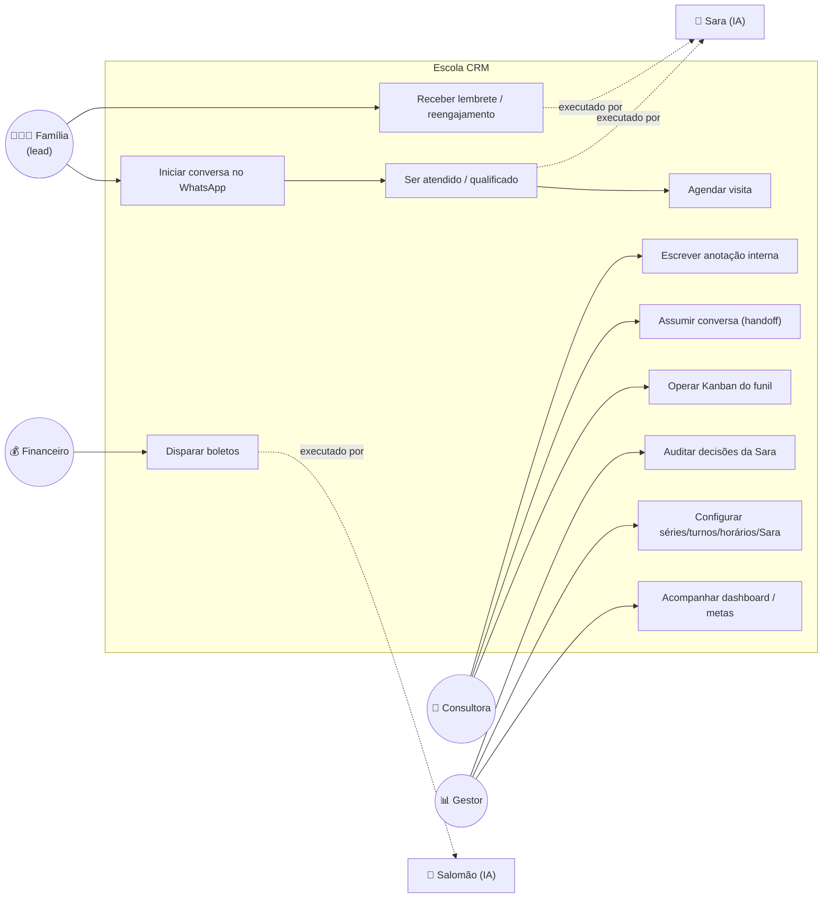
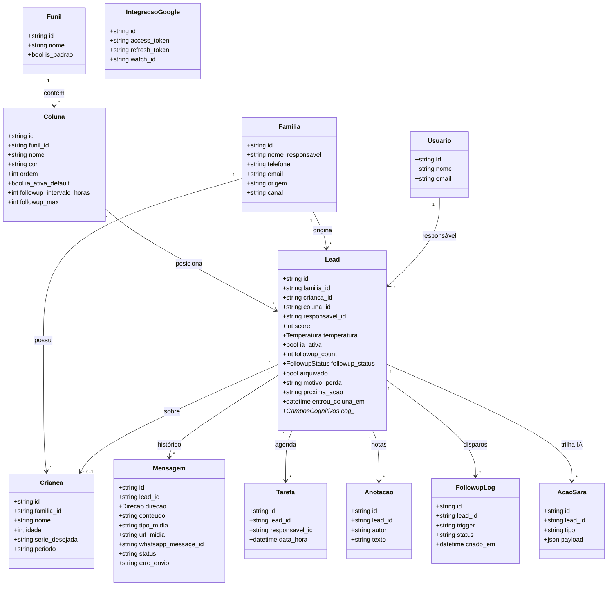
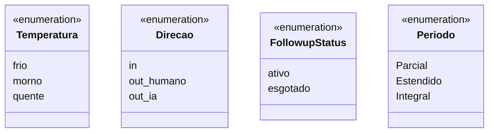
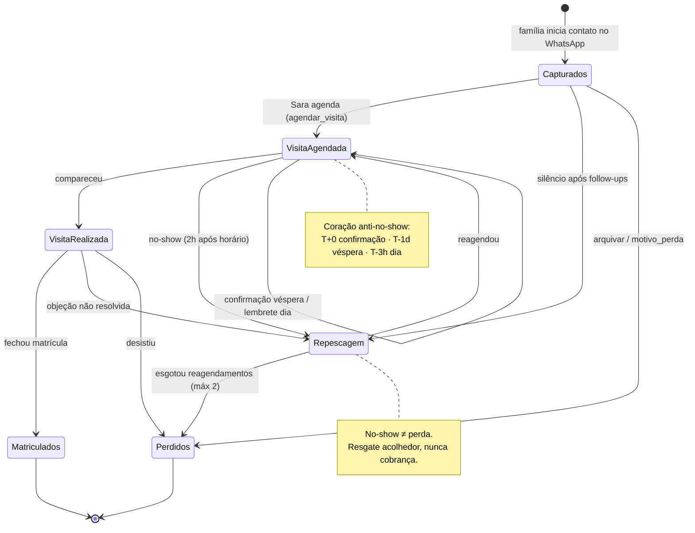
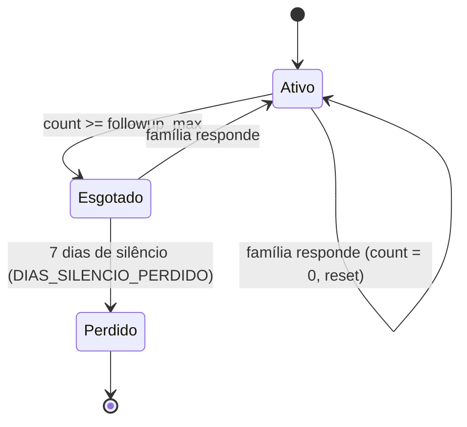
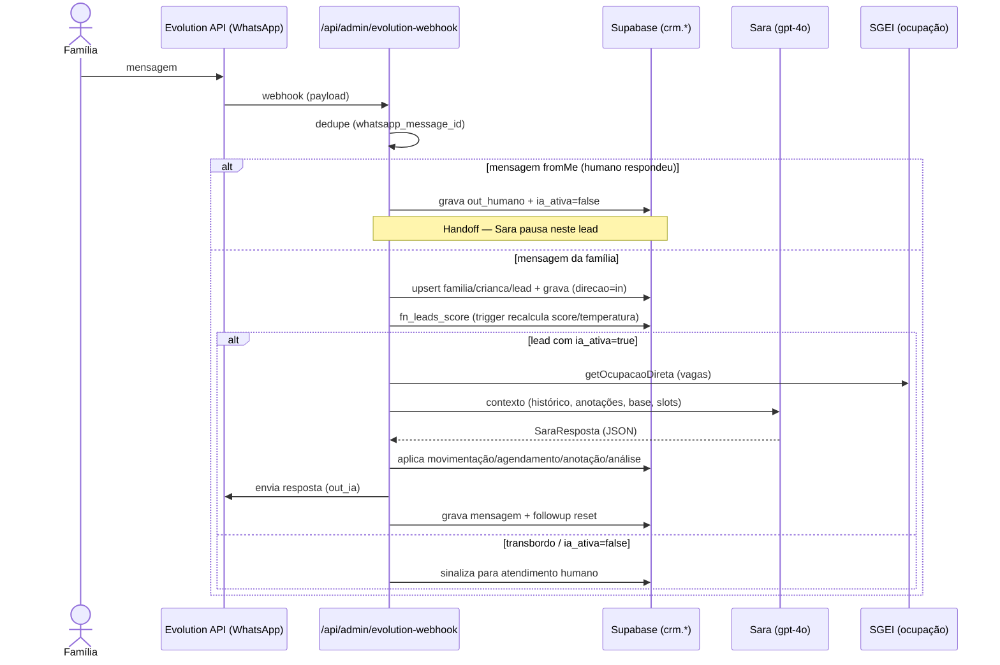
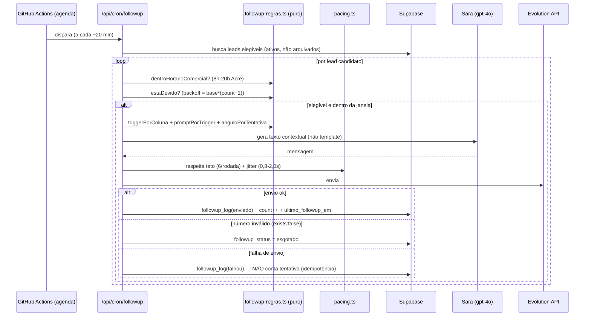
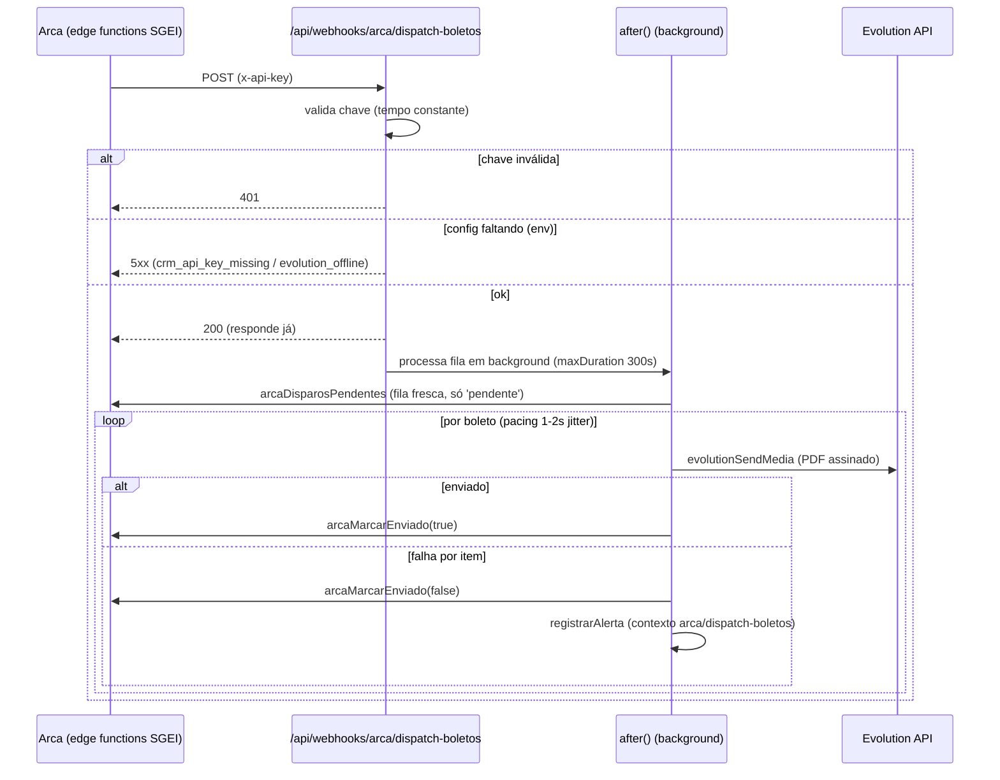
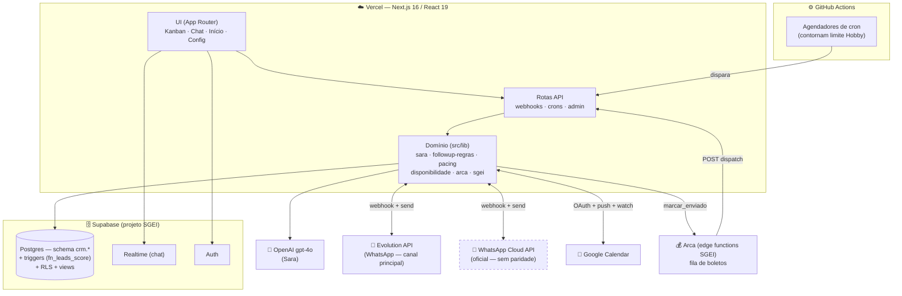

# UML — Escola CRM (Sara)

**Data:** 2026-08-12 · **Escopo:** modelagem visual do sistema como está hoje (as-built).
**Fontes:** `src/lib/types.ts`, `followup-regras.ts`, `sara.ts`, `arca.ts`, rotas em `src/app/api/*`, PRD (`docs/PRD-escola-crm.md`).
**Notação:** UML em Mermaid, organizado na visão **4+1** (lógica, processo, desenvolvimento, física, cenários).

> Renderiza direto no visualizador. A fonte de verdade do schema continua sendo `types.ts` + o banco Supabase; este documento é a leitura visual, não substitui a migration.

---

## 1. Visão de casos de uso (atores e o que fazem)



---

## 2. Visão lógica — diagrama de classes (modelo de domínio)

Reflete `src/lib/types.ts` e as tabelas usadas no código. Campos abreviados para legibilidade.



**Enums**



---

## 3. Visão lógica — máquina de estados do Lead (funil)

Estados = colunas do funil. Transições disparadas por conversa (Sara), ação humana (Kanban) ou cron.



**Sub-estado ortogonal — motor de follow-up** (independente da coluna):



---

## 4. Visão de processo — sequência: atendimento inbound (Sara)



---

## 5. Visão de processo — sequência: cron de follow-up



---

## 6. Visão de processo — sequência: Salomão (disparo de boletos)



---

## 7. Visão de desenvolvimento / física — componentes e deployment



> Linha tracejada = **dívida técnica** conhecida (canal WhatsApp Cloud sem paridade com o Evolution — ver PRD, Bloco C item 9).

---

## 8. Notas de fidelidade

- Nomes de estados na §3 são as colunas reais mapeadas em `followup-regras.ts` (`triggerPorColuna`): Capturados, Visita Agendada, Visita Realizada, Repescagem. "Em Atendimento", "Perdidos" e outras colunas configuráveis vivem em `colunas`/`funis` no banco e podem variar por funil.
- O enum `Periodo` na §2 usa os turnos **reais** (Parcial/Estendido/Integral). O `types.ts` ainda declara `matutino/vespertino/integral` no tipo `Crianca.periodo` — divergência a corrigir (PRD, Bloco A item 3).
- Parâmetros numéricos (8h–20h, teto 6/rodada, jitter 0,8–2,0s, backoff, 7 dias) são os defaults de `followup-regras.ts`/`pacing.ts` e da tabela `colunas`; ajustáveis sem alterar a modelagem.
```
